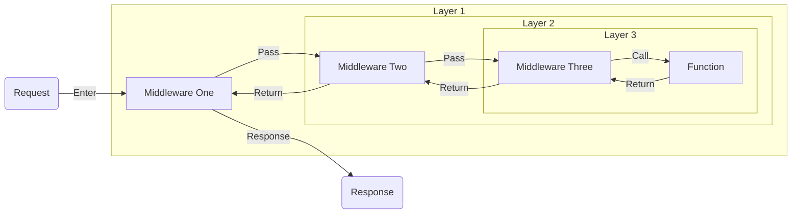

# Middleware

Middleware in Pikku follows an **onion model** - each middleware wraps around the next, running before and after your function executes. This is the same pattern used by Koa and Hono.

Think of it like layers wrapping a core: the request passes through each outer layer to reach the function at the center, then unwinds back out through the same layers to send the response.



## Your First Middleware

Let's write middleware that tracks response time:

```typescript @snippet firstMiddleware
```

The middleware:
- Destructures `logger` from services (tree-shaking benefit)
- Has access to the `wire` object (http, channel, queue, etc.)
- Calls `next()` to continue the chain
- Can run code before and after the function

## Built-in Middleware

Pikku provides built-in middleware for common authentication and CORS patterns via [`#pikku/middleware`](/api#app/middleware). Each one is a factory that returns middleware, so you build it with its options and then pass it to `addHTTPMiddleware('*', [...])` (or any other scope below).

### Bearer Token Authentication

With no token configured it decodes the bearer token with the JWT service. Give it a `token` and it compares in constant time against a fixed `value`, or against a secret resolved per request through `secretId`:

```typescript @snippet bearerAuth
```

### API Key Authentication

```typescript @snippet apiKeyAuth
```

### Cookie-Based Authentication

```typescript @snippet cookieAuth
```

### CORS

```typescript @snippet corsMiddleware
```

### Requiring an Origin

`cors()` only sets response headers, and the browser is what enforces them: a non-browser client ignores them and the request still runs. `requireOrigin` rejects with a 403 before your function body unless the request's `Origin` is this app's own or one you list. A missing `Origin` is rejected too. It stops another site's page posting to an unauthenticated route. It is not flood control.

```typescript @snippet requireOrigin
```

## Middleware Factories

Use `pikkuMiddlewareFactory` to create configurable middleware:

```typescript @snippet middlewareFactory
```

All built-in middleware (`authBearer`, `authAPIKey`, `authCookie`, `cors`, `requireOrigin`) are implemented using `pikkuMiddlewareFactory`.

## Middleware Signature

Every middleware has the same three parameters:

```typescript @snippet middlewareSignature
```

**Parameters:**
- **services** - Your singleton services only (destructure what you need). Wire services are not available in middleware.
- **wire** - The wire object containing transport-specific details (http, channel, queue, etc.)
- **next** - Function to call the next middleware or the main function

:::info Singleton Services Only
Middleware receives **only singleton services** in the first parameter, not wire services. This is because middleware wraps around the wire lifecycle. If you need access to wire-scoped resources, use the `wire` parameter to access them.
:::

## Authentication Middleware

A common use case is extracting authentication info:

```typescript @snippet authMiddleware
```

## Middleware Scopes

Pikku lets you apply middleware at different scopes. Understanding these scopes helps you find the right balance - too broad and you pay a performance cost, too narrow and you end up repeating yourself.

### Function-Level Middleware

Applied directly in your function definition:

```typescript @snippet functionMiddleware
```

Use function-level middleware for:
- Function-specific validation
- Business logic guards
- Operations that only make sense for this specific function

### Wire-Specific Middleware

Applied when wiring a function to a transport. Here a scheduled task records how long each run took:

```typescript @snippet cronMiddleware
```

Use wire-specific middleware for:
- Transport-specific concerns (rate limiting for HTTP, timing for scheduled tasks)
- Route-specific logging or auditing
- Overriding behavior for a specific endpoint

### HTTP Transport Middleware

For HTTP routes specifically, you can apply middleware globally (`'*'`) or per route pattern, such as everything under `/orders`:

```typescript @snippet httpMiddleware
```

Use HTTP transport middleware for:
- CORS headers for all HTTP routes
- Security headers for all HTTP responses
- Admin section protection
- API versioning concerns
- Different auth strategies per route pattern

### Global & Tag Middleware

To apply middleware across every wiring (HTTP, Channel, Queue, Scheduler, MCP, CLI, Workflow, Agent), use `addGlobalMiddleware`. To apply it to any wiring carrying a specific tag, use `addTagMiddleware`:

```typescript @snippet tagMiddleware
```

Use global and tag middleware for:
- Performance monitoring across all entry points (including scheduled tasks)
- Alerting on failures
- Cross-cutting auth for a tagged group of functions

## Channel Middleware

Regular middleware wraps a single request. A channel is different: it's one long connection carrying many messages. `wireChannel`'s `middleware` option wraps the connection (it runs on connect, where the session gets established), but a lot of channel concerns, like rate limiting or tracing, belong on **every message**. That's what channel middleware is for.

It has a different shape from `pikkuMiddleware`: it receives the event passing through, and passes it (or a changed version of it) on to `next`:

```typescript @snippet channelMiddleware
```

Attach it with the `channelMiddleware` option on `wireChannel`, for example `channelMiddleware: [traceAgentStream]`.

### Channel Middleware Factories

When the middleware needs options, use `pikkuChannelMiddlewareFactory`. One definition can then be wired several times with different configuration:

```typescript @snippet channelMiddlewareFactory
```

### By Tag

Like HTTP and tag middleware, you can keep the channels themselves free of the wiring. `addChannelMiddleware` attaches channel middleware to every channel carrying the given tag:

```typescript @snippet addChannelMiddleware
```

See [Channels](/docs/wiring/channels) for the rest of the channel wiring.

## Agent Middleware

An AI agent run isn't a request either, it's a loop of model turns and tool calls. `pikkuAgentMiddleware` declares hooks for that loop instead of a single `next` chain. You provide only the hooks you need:

- `modifyInput` - rewrite the messages and instructions the model is about to see, before each turn
- `modifyOutput` - rewrite the finished output of a turn, after streaming completes
- `modifyOutputStream` - see the output as it streams, for redaction or live inspection. It gets its own `state`, which persists across chunks
- `beforeToolCall` - rewrite the arguments the model chose for a tool
- `afterToolCall` - replace a tool's result before the model sees it
- `afterStep` - observe the end of each model turn (it can't change anything)
- `onError` - runs when a turn throws, for logging and cleanup (it doesn't swallow the error)

```typescript @snippet agentMiddleware
```

Pass it to an agent through its `agentMiddleware` option. See [AI Agents](/docs/wiring/ai-agents) for the full picture.

## Execution Order

Middleware executes from the broadest scope inward to the most specific. Think of it like layers of an onion - the outer layers run first:

1. **Global middleware** - Every wiring (`addGlobalMiddleware([...])`)
2. **Transport-specific middleware** - All HTTP routes (`addHTTPMiddleware('*', [...])`)
3. **Pattern-based middleware** - HTTP routes matching an anchored glob (`addHTTPMiddleware('/prefix/*', [...])`)
4. **Tag middleware** - Wirings carrying a matching tag (`addTagMiddleware('tag', [...])`)
5. **Wire-specific middleware** - Defined in `wireHTTP`/`wireChannel`/etc.
6. **Function-level middleware** - Defined in function config

After the function completes, they run in reverse order (onion model).

Example showing all scopes:

```typescript @snippet middlewareOrder
```

For this request, middleware runs in this order:
1. `securityHeaders` (transport-specific - all HTTP)
2. `apiKeyValidation` (pattern-based - matches '/api/v1/*')
3. `rateLimit` (wire-specific)
4. `validatePriceChange` (function-level)
5. `auditPriceChange` (function-level)
6. **Your function runs**
7. `auditPriceChange` (after)
8. `validatePriceChange` (after)
9. `rateLimit` (after)
10. `apiKeyValidation` (after)
11. `securityHeaders` (after)

## Wire Object

Middleware receives a `wire` object that varies by transport:

```typescript @snippet transportAware
```

## Error Handling

Middleware can catch and transform errors:

```typescript @snippet errorHandlerMiddleware
```

## Conditional Middleware

Sometimes you only want middleware to run in certain conditions:

```typescript @snippet conditionalCache
```

## Automatic Schema Validation

Pikku automatically generates and validates schemas based on your TypeScript types. No middleware needed for input validation - it happens before your function runs.

If validation fails, Pikku throws an [`UnprocessableContentError`](/api#app/error) (HTTP 422) carrying the validator's report of which fields failed.

## Best Practices

**Destructure services** - Helps Pikku tree-shake unused services. Destructure only what you need (`({ logger }, wire, next)`) rather than taking the whole `services` object, which bundles every service.

:::tip Transport-Agnostic vs Transport-Specific Middleware
**Prefer function-level middleware for transport-agnostic logic** - Logging, metrics, validation, etc. should work regardless of whether your function is called via HTTP, WebSocket, or queue.

**Use transport-specific middleware (like `addHTTPMiddleware`) for HTTP-only concerns** - Things like cookie parsing, CORS headers, or security headers that only make sense for HTTP. These middleware should throw `InvalidMiddlewareWireError` if used on non-HTTP transports to fail fast:

```typescript @snippet cookieParser
```

This ensures your middleware fails fast if accidentally used on the wrong transport, rather than silently doing nothing or causing subtle bugs.
:::

**Keep middleware focused** - Each middleware should do one thing well. Separate auth, logging and metrics into their own middleware and list them side by side, rather than writing one that does all three.

## Next Steps

- [Permissions](./permission-guards.md) - Authorization and permissions
- [Functions](./functions.md) - Understanding Pikku functions
- [HTTP Wiring](../wiring/http/index.md) - Wire functions to HTTP routes
