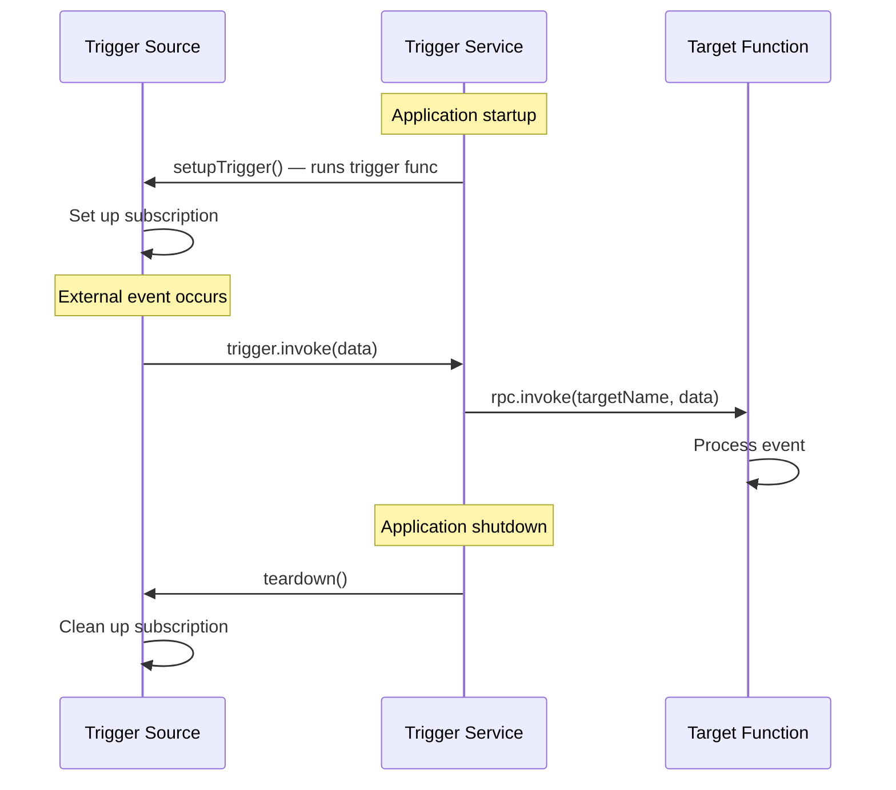

# Triggers

Triggers let you subscribe to external events and react when they occur. Redis pub/sub messages, database change streams, Telegram updates, or any event source — triggers provide a consistent pattern for event-driven code.

A trigger has two parts:
1. **Trigger source** — a function that sets up a subscription and fires events (`pikkuTriggerFunc`)
2. **Trigger target** — an RPC function or workflow that runs when the trigger fires

## Your First Trigger

Here's a complete trigger example from the templates. The source polls an event using `setInterval`, and the target function processes the payload:

Source: [`trigger.functions.ts`](https://github.com/pikkujs/pikku/blob/main/templates/functions/src/functions/trigger.functions.ts)

Source: [`trigger.wiring.ts`](https://github.com/pikkujs/pikku/blob/main/templates/functions/src/wirings/trigger.wiring.ts)

The trigger function:
1. Receives services and input configuration
2. Sets up the subscription (interval, pub/sub listener, etc.)
3. Calls `trigger.invoke(data)` when events occur
4. Returns a teardown function for cleanup

## How It Works



The trigger service handles the lifecycle automatically:
1. On startup, it calls your trigger function which sets up the subscription
2. When events arrive, `trigger.invoke()` dispatches to the target via RPC
3. On shutdown, it calls the teardown function to clean up

## Declaration vs Source

The two-part wiring pattern separates **what to do** from **how to detect events**:

- **`wireTrigger`** — declares the trigger name and its target function
- **`wireTriggerSource`** — registers the subscription implementation

The trigger source (the thing listening for events) often runs on a different machine from the consumer (the function that reacts). For example, a Redis subscriber might run on a dedicated worker while the target RPC function runs on your API servers. Splitting the declaration from the source lets you deploy them independently — each side only imports what it needs.

## Real-World Examples

### Redis Pub/Sub

A Redis trigger source is a `pikkuTriggerFunc` with `{ channels: string[] }` as its input and `{ channel, message }` as its output. In `func`, duplicate the Redis client, listen for `message` events and call `trigger.invoke({ channel, message: JSON.parse(message) })`, then subscribe to the channels. Return a teardown function that unsubscribes and quits the duplicated client.

### PostgreSQL Change Streams

A Postgres source takes `{ table, events }` (the events being `INSERT`, `UPDATE` and `DELETE`) and fires `{ event, table, data }`. In `func`, connect a client, create a `pg_notify` function and a trigger on the table for each event, listen for `notification` messages on the channel and call `trigger.invoke(JSON.parse(payload))`, then run `LISTEN`. The teardown runs `UNLISTEN` and releases the client.

### Polling

The template's `testEventTrigger` (shown in the "Your First Trigger" section above) is a polling trigger — it fires every second using `setInterval`. See `trigger.functions.ts` for the complete implementation.

Note that `pikkuTriggerFunc` supports both the config object syntax (with `title`, `description`, etc.) and the direct function syntax shown in the template.

## Triggering Workflows

Triggers can also start [graph workflows](../workflows/index.md) instead of simple RPC calls:

Declare the trigger with `wireTrigger({ name, func, description })`, as in the low-stock example below. When `func` is a workflow, the trigger starts a new workflow execution each time it fires.

When the trigger fires, it starts a new workflow execution instead of calling a single function.

## Trigger Metadata

Like other Pikku functions, trigger sources support metadata for documentation and organization:

A trigger source takes these options: `title`, `description`, `tags`, `input` and `output` (Standard Schemas for validation), and `func`, which receives the services, the input and `{ trigger }`.

## Trigger Service

Triggers are managed by a `TriggerService` that handles their lifecycle. Pikku provides `InMemoryTriggerService` for single-process deployments:

Create an `InMemoryTriggerService` (from `@pikku/core/services`) and pass it to `createSingletonServices` as `triggerService`. After the server starts, call `await triggerService.start()`; the service reads its singleton and wire services from the generated bootstrap automatically. On shutdown, call `await triggerService.stop()`.

The `InMemoryTriggerService`:
1. Reads all `wireTrigger` and `wireTriggerSource` registrations from state
2. For each source that has a matching trigger declaration, sets up the subscription
3. When `trigger.invoke()` is called, dispatches to the target via RPC
4. On `stop()`, calls the teardown function returned by each trigger source

### TriggerService Interface

A `TriggerService` has two methods, `start()` and `stop()`, both returning a promise.

For workflows that use both queues and triggers, initialize the trigger service after the queue and workflow services are ready.

## Real-World Example: Low-Stock Alert

From the [online shop template](https://github.com/pikkujs/fabric/tree/main/templates/online-shop-template) — the `updateItem` function fires a low-stock trigger when item stock drops below a threshold, and this handler reacts to it.

```typescript @snippet lowStockTrigger
```

In production you'd replace the `logger.warn` with a Slack notification, a restocking ticket, or any side-effect you need.

## Use Cases

- **Message queues** — Redis pub/sub, AMQP, MQTT
- **Database changes** — PostgreSQL LISTEN/NOTIFY, MongoDB change streams
- **External APIs** — Telegram bots, webhook polling, RSS feeds
- **File system** — File watchers, directory monitors
- **Custom sources** — Any event-driven system

## Next Steps

- [Functions](../../core-features/functions.md) — Understanding Pikku functions
- [Workflows](../workflows/index.md) — Multi-step processes triggered by events
- [Scheduled Tasks](../scheduled-tasks.md) — Time-based triggers
- [`#pikku/trigger` in the SDK explorer](/api#app/trigger) — every export on the trigger door
